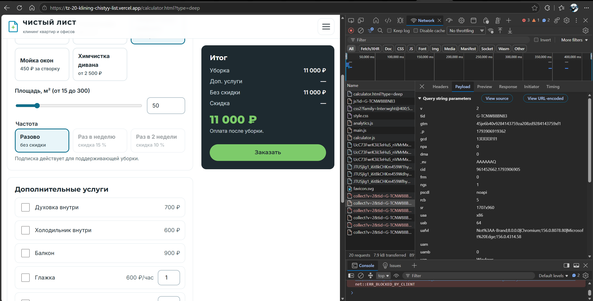
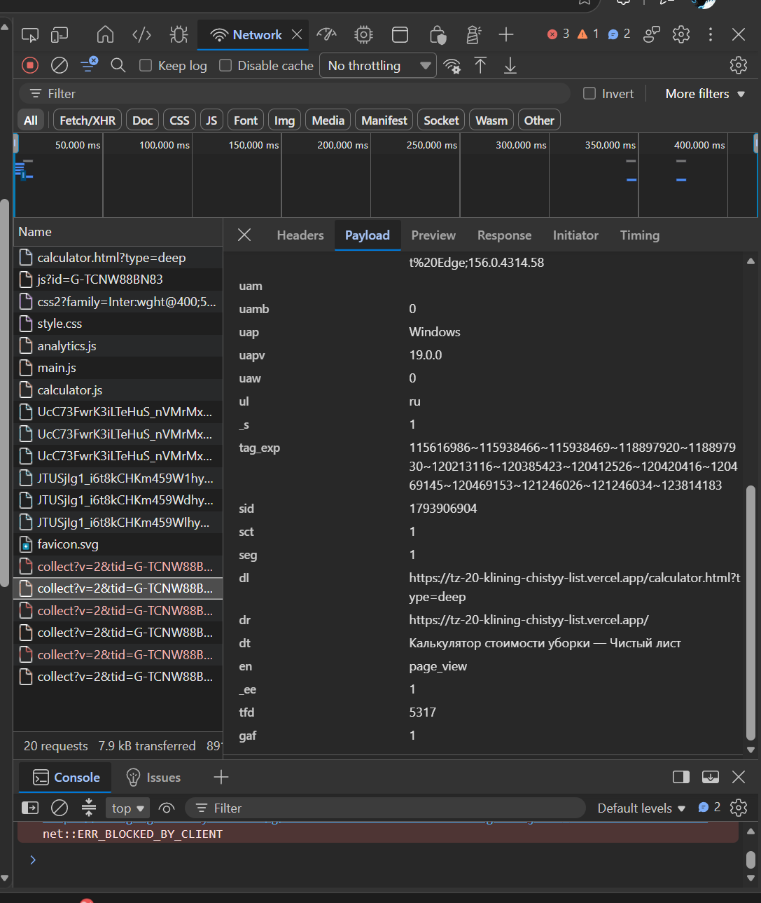

# Домашняя работа № 1 · Путь данных от ссылки до заявки

**Дисциплина:** ОП.03 «Информационные технологии»

| Поле | Значение |
|---|---|
| Фамилия, имя, отчество | Исмаилов Алишах Иса оглы |
| Группа |  |
| Номер работы | 1 |
| Тема работы | Цифровая воронка: путь данных от ссылки до заявки |
| Дата сдачи | 05.11.2026 |

---

## Задание

1. Открыть сайт, панель разработчика (F12) → **Network**, в фильтре `collect`,
   галочка **Preserve log**.
2. Сделать три действия: обновить страницу, прокрутить до низа, нажать
   на товар. Записать, какие события ушли — параметр `en` на вкладке **Payload**.
3. Описать путь пользователя от ссылки до заявки, пять шагов.
4. Найти одно место на этом пути, где данные могут потеряться.
5. Приложить скриншоты `screens/01-network.png` и `screens/02-payload.png`.

Сайт: https://shop.merch.google/, запасные — https://habr.com/ru/,
https://www.smashingmagazine.com/, https://css-tricks.com/. Открывать
в Chrome или Edge с выключенным блокировщиком рекламы.

Срок — до начала занятия 2. Работа сдаётся коммитом в `main`.

---

## 1. Какой сайт смотрел

| Поле | Значение |
|---|---|
| Название сайта | «Чистый лист» — сайт клининговой компании (курсовая работа, ТЗ-20) |
| Адрес | https://tz-20-klining-chistyy-list.vercel.app/ |
| Откуда сайт | свой |

## 2. Три действия и что отправил счётчик

Панель Network, фильтр `collect`, галочка Preserve log. Название события
лежит в параметре `en` на вкладке Payload.

В первой строке стоит пример. **Удалите его** и впишите свои три.

| № | Что я сделал на сайте | Название события (`en`) | Что ещё было в Payload |
|---|---|---|---|
| 1 | обновил страницу калькулятора | `page_view` | `tid` = G-TCNW88BN83, `dl` = адрес страницы `…/calculator.html?type=deep`, `dr` = главная, откуда пришёл, `dt` = «Калькулятор стоимости уборки — Чистый лист», `sid` — номер сеанса |
| 2 | прокрутил до низа | `scroll` | `epn.percent_scrolled` = 90, `dl` — та же страница |
| 3 | нажал на карточку «Поддерживающая уборка» на главной | `service_view` | `ep.cleaning_type` = regular — какую услугу смотрели |

Скриншоты:

## 3. Путь пользователя: 5 шагов

От ссылки до заявки, своими словами. Панель для этого не нужна: это рассказ
о том, как человек доходит до кнопки «Отправить». В правом столбце стоит
пример, в левом вы пишете свой вариант.

| № | Мой шаг | Пример |
|---|---|---|
| 1 | человек видит в Instagram Stories акцию «Генеральная уборка −15 %» и нажимает стикер-ссылку с UTM-метками | *человек увидел ссылку в сообществе и нажал на неё* |
| 2 | открывается калькулятор, метки сохраняются в `sessionStorage`, уходит `page_view` | *открылась главная страница сайта* |
| 3 | он выбирает вид уборки и площадь, видит цену (`cleaning_calc`) и нажимает «Заказать» (`cta_click`) | *он прокрутил до формы записи* |
| 4 | на странице заказа выбирает дату и время (`date_select`), вводит имя и телефон (`form_start`) | *начал заполнять: имя и телефон* |
| 5 | нажимает «Отправить заказ», заявка с метками попадает в Google Таблицу, уходит `generate_lead` | *нажал «Отправить», заявка ушла менеджеру* |

## 4. Где данные могут потеряться

В первой строке стоит пример, **удалите его**. Строку 1 заполняют все,
строку 2 заполняйте по желанию.

| № | На каком шаге | Что может потеряться |
|---|---|---|
| 1 | шаг 1–2, переход по ссылке | у посетителя включён блокировщик рекламы: запросы `collect` не уходят (`ERR_BLOCKED_BY_CLIENT` на скриншоте), визит и источник не попадают в GA4, хотя заявка в таблицу придёт |
| 2 | шаг 5, отправка формы | нет интернета или приёмник Apps Script не ответил: заявка не записалась, `generate_lead` не ушёл, человек видит ошибку и может уйти |

## 5. Использование ИИ

| Вопрос | Ответ |
|---|---|
| Что сделал сам |  |
| Что спросил у модели |  |
| Что после этого изменил |  |
