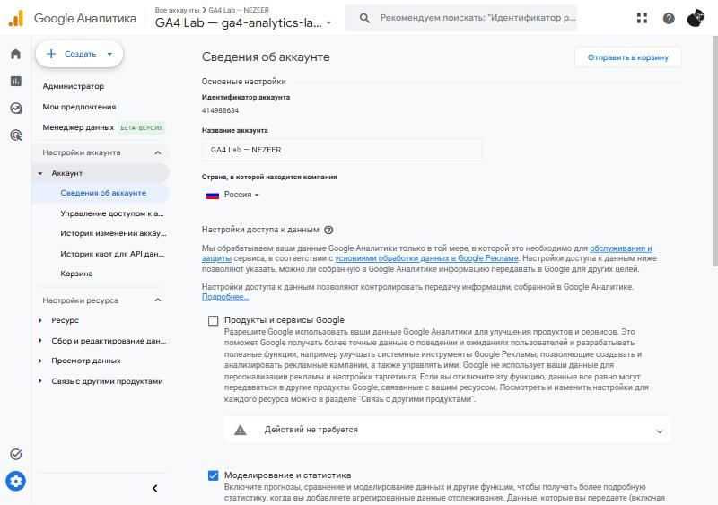
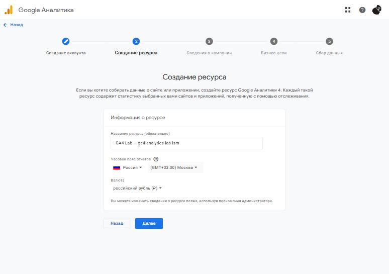
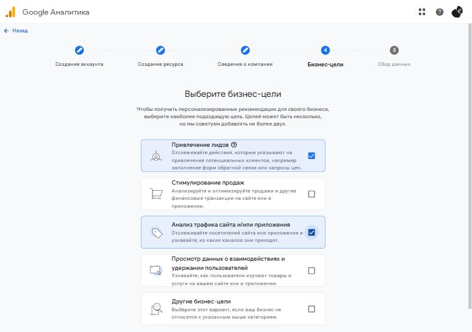
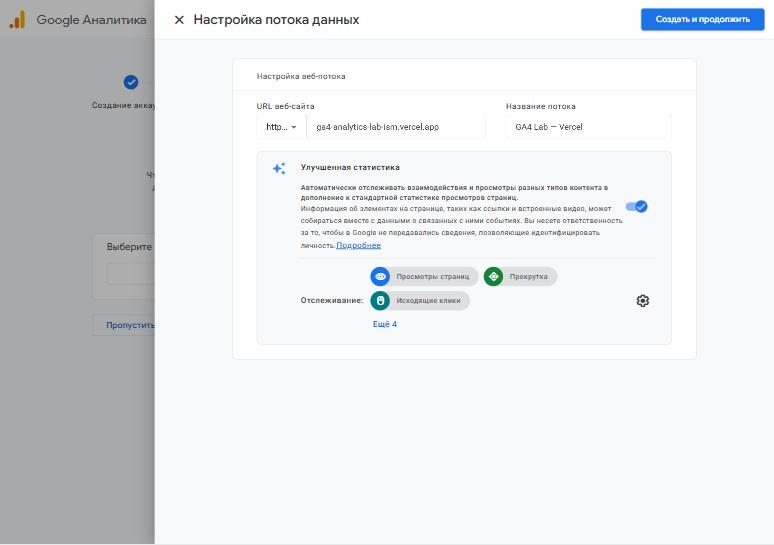
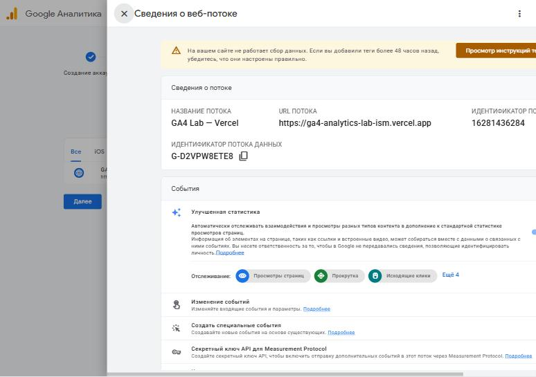

# Домашняя работа № 2 · Где бизнес теряет клиентов

**Дисциплина:** ОП.03 «Информационные технологии»

| Поле | Значение |
|---|---|
| Фамилия, имя, отчество | Исмаилов Алишах Иса оглы |
| Группа |  |
| Номер работы | 2 |
| Тема работы | Анализ воронки цифрового продукта и структура Google Analytics 4 |
| Дата сдачи | 05.11.2026 |

---

# Часть 1. Исследование воронки

## 1.1. Объект исследования

| Поле | Значение |
|---|---|
| Компания, сервис или отрасль | Qlean — российский онлайн-сервис заказа уборки квартир и офисов |
| Адрес сайта или приложения | https://qlean.ru/ (приложение «Qlean — уборка квартир» в App Store и RuStore) |
| Целевое действие | оформленный и подтверждённый заказ уборки; для бизнеса важнее — повторный заказ |
| Почему выбран этот объект | курсовая по ТЗ-20 — сайт клининговой компании «Чистый лист», поэтому интересно разобрать, где теряет клиентов крупный сервис той же отрасли, в котором заказ тоже идёт через расчёт цены и форму с датой |

## 1.2. Воронка

От 4 до 7 этапов, по порядку.

| № | Этап | Что считается переходом дальше | Метрика этапа |
|---|---|---|---|
| 1 | Реклама или соцсети → переход на сайт | человек кликнул ссылку и страница загрузилась | клики и сеансы по источникам, доля отказов |
| 2 | Страница услуги | человек открыл расчёт стоимости | доля сеансов с открытием калькулятора |
| 3 | Расчёт цены (площадь, вид уборки, допуслуги) | нажал «Заказать» | доля расчётов, после которых нажата кнопка заказа |
| 4 | Оформление: дата, адрес, контакты | форма отправлена | конверсия из начала заполнения в отправку |
| 5 | Оплата и подтверждение | заказ подтверждён | доля оплаченных заказов от начатых оформлений |
| 6 | Повторный заказ или подписка | клиент заказал уборку ещё раз | доля повторных заказов в когорте за месяц |

## 1.3. Источники

Не менее пяти. Каждый разбирается по пяти пунктам.

### Источник 1

| Поле | Значение |
|---|---|
| Название материала | 50 Cart Abandonment Rate Statistics 2026 – Cart & Checkout |
| Автор или организация | Baymard Institute |
| Дата публикации | обновлено 22.09.2025 |
| Прямая ссылка | https://baymard.com/lists/cart-abandonment-rate |

**Выписка из материала** (ключевая мысль, цифра, наблюдение, результат):

> Средняя доля брошенных корзин по 50 исследованиям — 70,22 %. Причины отказа при оформлении: «Extra costs too high» — 40 %, требование создать аккаунт — 18 %, «too long / complicated checkout process» — 17 %, не видна итоговая цена заранее — 12 %.

**Что подтверждает и как связано с моей воронкой** (своими словами):

> Источник показывает, что большая часть людей уходит уже на оформлении, и называет причины. Для сервиса уборки это этапы 3–5: если итоговая цена с допуслугами всплывает только в конце или нужна регистрация, человек уходит.

**Цифры из источника и этап воронки, к которому относятся:**

> 70,22 % — этапы 4–5 (оформление и оплата); 40 % и 12 % (неожиданные и невидимые заранее расходы) — этап 3, расчёт цены; 18 % и 17 % (регистрация, длинное оформление) — этап 4.

### Источник 2

| Поле | Значение |
|---|---|
| Название материала | Более 70% корзин в российских онлайн-магазинах остаются неоплаченными |
| Автор или организация | аналитики Тинькофф eCommerce, публикация Retail.ru |
| Дата публикации | 29.11.2023 |
| Прямая ссылка | https://www.retail.ru/news/bolee-70-korzin-v-rossiyskikh-onlayn-magazinakh-ostayutsya-neoplachennymi/ |

**Выписка из материала** (ключевая мысль, цифра, наблюдение, результат):

> Более 70 % корзин в российских онлайн-магазинах остаются неоплаченными. 71 % покупателей откажутся, если оформление разбито на несколько страниц и данные не сохраняются; 65 % — если много обязательных полей; 58 % — если просят больше личных данных, чем нужно.

**Что подтверждает и как связано с моей воронкой** (своими словами):

> Это российские данные, они подтверждают выводы Baymard для нашего рынка. Для воронки уборки важен вывод про форму: чем больше обязательных полей и шагов, тем больше потерь между началом оформления и отправкой.

**Цифры из источника и этап воронки, к которому относятся:**

> >70 % — этап 5 (оплата); 71 %, 65 %, 58 % — этап 4 (форма оформления).

### Источник 3

| Поле | Значение |
|---|---|
| Название материала | Каждая вторая брошенная корзина становилась заказом — данные RetailCRM |
| Автор или организация | RetailCRM (Дмитрий Бороздин, сооснователь и CEO) |
| Дата публикации | 15.05.2026 |
| Прямая ссылка | https://www.retail.ru/rbc/pressreleases/kazhdaya-vtoraya-broshennaya-korzina-stanovitsya-zakazom-dannye-retailcrm/ |

**Выписка из материала** (ключевая мысль, цифра, наблюдение, результат):

> Конверсия из брошенной корзины в заказ — 46 %. Доля брошенных корзин в I квартале 2026 года — 88 %. Среднее время от брошенной корзины до заказа сократилось с 7 до 2 дней: «напоминания срабатывали быстрее».

**Что подтверждает и как связано с моей воронкой** (своими словами):

> Ушедший на этапе оформления клиент не потерян окончательно: почти половину можно вернуть напоминанием. Для сервиса уборки это значит, что незавершённое оформление нужно сохранять и напоминать о нём.

**Цифры из источника и этап воронки, к которому относятся:**

> 88 % брошенных — этапы 4–5; 46 % возвращённых и 2 дня до заказа — возврат на этап 5.

### Источник 4

| Поле | Значение |
|---|---|
| Название материала | История успеха Qlean |
| Автор или организация | МойСклад, интервью с сооснователем Qlean Александром Коровиным |
| Дата публикации | 11.03.2016 |
| Прямая ссылка | https://www.moysklad.ru/poleznoe/stories/istoriya-uspekha/ |

**Выписка из материала** (ключевая мысль, цифра, наблюдение, результат):

> Повторные продажи названы «самый критичный показатель», потому что одну уборку нельзя «отбить» с первого визита. Компания делает ежемесячный когортный анализ повторных продаж и среднего чека и по нему сравнивает источники трафика. «Сарафанное радио — наш главный инструмент продвижения».

**Что подтверждает и как связано с моей воронкой** (своими словами):

> Источник подтверждает, что для сервиса уборки воронка не заканчивается первым заказом: деньги приносит этап 6, повторный заказ. Поэтому источники трафика нужно сравнивать не только по заявкам, но и по повторным заказам.

**Цифры из источника и этап воронки, к которому относятся:**

> 600 квартир в день, рост в 15 раз за 2015 год — масштаб сервиса; точные показатели конверсии и повторных заказов в открытом источнике не приведены. Относится к этапам 1 (источники) и 6 (повторный заказ).

### Источник 5

| Поле | Значение |
|---|---|
| Название материала | New Industry Benchmarks for Mobile Page Speed |
| Автор или организация | Daniel An, Google (исследование Google/SOASTA Research, 2017) |
| Дата публикации | 28.02.2017 |
| Прямая ссылка | https://blog.amp.dev/2017/02/28/new-industry-benchmarks-for-mobile-page-speed/ |

**Выписка из материала** (ключевая мысль, цифра, наблюдение, результат):

> Когда время загрузки растёт с одной секунды до семи, вероятность отказа увеличивается на 113 %. «The average time it takes to fully load a mobile landing page is 22 seconds».

**Что подтверждает и как связано с моей воронкой** (своими словами):

> Большинство переходов из соцсетей идут с телефона. Если страница после клика грузится долго, человек уходит ещё до того, как увидит услугу, — потеря на самом первом этапе.

**Цифры из источника и этап воронки, к которому относятся:**

> +113 % вероятности отказа и 22 секунды средней загрузки — этап 1, переход на сайт.

## 1.4. Реальные кейсы

Не менее двух, российские компании или российский рынок. Каждый разбирается по семи
пунктам. Если показатели не опубликованы, пишется: «точные показатели
в открытом источнике не приведены».

### Кейс 1

| № | Пункт | Ответ |
|---|---|---|
| 1 | Компания, продукт или рынок | ООО «Юниант», торговля (Россия); агентство «Эмпирикс», Новосибирск; реклама в Яндекс Директе, 2023 год |
| 2 | Как выглядела воронка или её проблемный участок | реклама → сайт → открытие формы запроса прайс-листа → отправка формы; проблемный участок — между открытием формы и отправкой |
| 3 | В чём заключалась проблема | «Форма обратной связи была перегружена большим количеством обязательных полей» |
| 4 | Какие данные или наблюдения подтвердили проблему | конверсия из открытия формы в отправку — менее 5 %, общая конверсия в целевой визит — около 1,5 % |
| 5 | Что изменили или протестировали | обязательных полей стало 3 вместо 6 (имя, телефон, e-mail), комментарий стал необязательным, добавлено описание обработки заявки и маски ввода телефона и e-mail |
| 6 | Как изменился результат | конверсия формы выросла примерно в 3 раза (с 5 до 13 %, на графике агентства — 21,49 %), общая конверсия — с 1,5 до 6 %, стоимость заявки — с 840 до 300 ₽ без роста бюджета |
| 7 | Переносим ли подход на мой объект | да: в форме заказа уборки обязательны только телефон, вид уборки, площадь и дата, адрес и детали менеджер уточнит при звонке |

**Ссылка на источник кейса:**

> https://workspace.ru/cases/povysili-konversiyu-v-3-raza-i-snizili-cpl-v-2-8-raza-za-schet-dorabotki-formy-na-sayte/

### Кейс 2

| № | Пункт | Ответ |
|---|---|---|
| 1 | Компания, продукт или рынок | «РосДеньги», российская микрофинансовая компания; агентство Colary; 2017 год |
| 2 | Как выглядела воронка или её проблемный участок | главная страница → онлайн-анкета → заявка; анкета — главный инструмент превращения трафика в заявки |
| 3 | В чём заключалась проблема | от анкеты зависит весь онлайн-канал: его финансовый успех «напрямую зависит от его эффективности»; какая именно проблема была в старой анкете, в открытом источнике не описано — изменения направлены на то, чтобы сократить путь до заявки и ускорить заполнение |
| 4 | Какие данные или наблюдения подтвердили проблему | точные показатели до изменений в открытом источнике не приведены, кроме недельных цифр: 14–15 тыс. просмотров, 600 заявок, конверсия 6–7 % |
| 5 | Что изменили или протестировали | заметная кнопка «Получить деньги» и мини-калькулятор на главной, анкета из 4 шагов, которую можно отправить после второго, автозаполнение адреса через DaData, маски ввода, мобильная версия формы |
| 6 | Как изменился результат | за неделю: заявок — 2 500 вместо 600, конверсия — 11–13 % вместо 6–7 %, просмотры — 30–35 тыс. |
| 7 | Переносим ли подход на мой объект | да: калькулятор цены на первом экране и короткая форма с выбором даты, которую можно отправить без адреса, подходят и сервису уборки |

**Ссылка на источник кейса:**

> https://ruward.ru/cases/1113/

## 1.5. Причины потери пользователей

Не менее трёх. Каждая опирается на найденные материалы.

| № | Этап воронки | Причина потери | Какой источник это подтверждает |
|---|---|---|---|
| 1 | 1. Переход на сайт | страница долго грузится на телефоне, человек уходит до того, как увидел услугу | источник 5 (Google/SOASTA: +113 % вероятности отказа при росте загрузки с 1 до 7 с) |
| 2 | 3. Расчёт цены | итоговая цена с допуслугами не видна заранее или в конце появляются неожиданные доплаты | источник 1 (Baymard: 40 % — лишние расходы, 12 % — не видна итоговая цена) |
| 3 | 4. Оформление | много обязательных полей, несколько шагов, требование регистрации | источник 2 (Тинькофф eCommerce: 65 % и 71 %), источник 1 (18 % — регистрация), кейс 1 |
| 4 | 6. Повторный заказ | после первой уборки клиента не возвращают, хотя доход дают повторные заказы | источник 4 (Qlean: повторные продажи — «самый критичный показатель») |

## 1.6. Гипотезы улучшения

Не менее трёх, собственные.

| № | Этап | Гипотеза | Какие данные нужно собрать | Как проверить, сработало |
|---|---|---|---|---|
| 1 | 3. Расчёт цены | если показывать итоговую цену с допуслугами и скидкой прямо в калькуляторе, больше людей нажмут «Заказать» | событие расчёта цены и клик «Заказать» в GA4, итоговая сумма в параметре события | доля расчётов с кликом «Заказать» за 2 недели до и после изменения, по сеансам с телефона и компьютера отдельно |
| 2 | 4. Оформление | если оставить обязательными только телефон, вид уборки, площадь и дату, конверсия формы вырастет | начало заполнения формы, отправка, ошибки по каждому полю (`form_error` с названием поля) | конверсия из начала заполнения в отправку и число ошибок по полям до и после; A/B-тест двух вариантов формы |
| 3 | 4–5. Возврат брошенных | если клиент начал оформление и оставил телефон, напоминание в течение суток вернёт часть заказов | список незавершённых оформлений с контактом, время ухода, факт заказа после напоминания | доля вернувшихся из получивших напоминание по сравнению с контрольной группой без напоминания |
| 4 | 6. Повторный заказ | предложение подписки со скидкой сразу после первой уборки увеличит долю повторных заказов | номер заказа клиента, источник первого визита (UTM), выбор подписки | доля повторных заказов в месячной когорте до и после; сравнение когорт по источникам трафика |

---

# Часть 2. Google Analytics 4

## 2.1. Пройденные шаги

| № | Шаг | Выполнено |
|---|---|---|
| 1 | Вход в Google Analytics под своим аккаунтом | да |
| 2 | Создан Analytics Account | да |
| 3 | Создан Property | да |
| 4 | Выбраны часовой пояс, валюта и общие сведения | да |
| 5 | Выбраны бизнес-цели | да |
| 6 | Создан ресурс | да |
| 7 | Создан Web Data Stream | да |
| 8 | Проверены Website URL, Stream name, Enhanced Measurement | да |
| 9 | Поток создан | да |
| 10 | Найден Measurement ID | да |

## 2.2. Что получилось

| Поле | Значение |
|---|---|
| Analytics Account | GA4 Lab — NEZEER |
| Property | GA4 Lab — ga4-analytics-lab-ism |
| Reporting time zone | (GMT+03:00) Москва, Россия |
| Currency | российский рубль (₽) |
| Выбранные бизнес-цели | Привлечение лидов; Анализ трафика сайта и/или приложения |
| Stream name | GA4 Lab — Vercel |
| Website URL | https://ga4-analytics-lab-ism.vercel.app |
| Stream ID (числовой) | 16281436284 |
| Measurement ID (`G-…`) | G-D2VPW8ETE8 |
| Enhanced Measurement | включено |

Stream ID и Measurement ID — это разные идентификаторы. На сайт в задании 3
ставится второй, вида `G-XXXXXXXXXX`.

## 2.3. Скриншоты

---

## Использование ИИ

Источники вы ищете, читаете и проверяете сами, настройку проходите тоже
сами. ИИ допускается для поиска идей, структурирования и проверки
формулировок, но источником он не считается.

| Вопрос | Ответ |
|---|---|
| Что сделано самостоятельно |  |
| Что спрошено у модели |  |
| Что после этого проверено и изменено |  |
