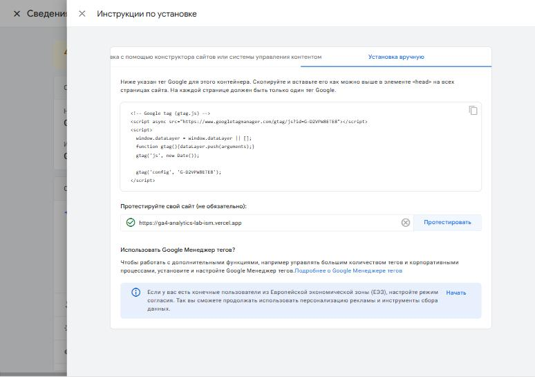
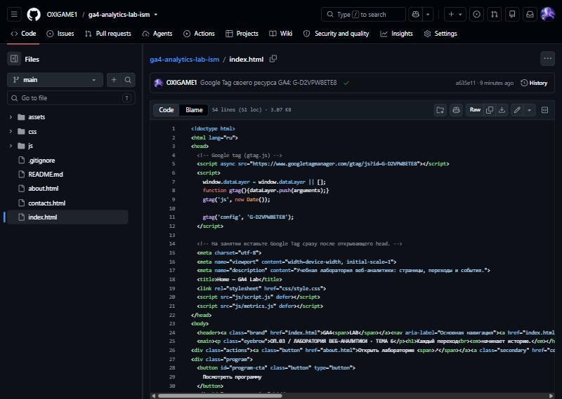
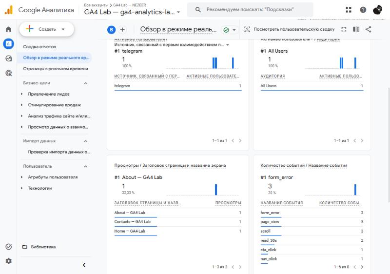

# Домашняя работа № 3 · Тег на сайте, источник и отчёты GA4

**Дисциплина:** ОП.03 «Информационные технологии»

| Поле | Значение |
|---|---|
| Фамилия, имя, отчество | Вобленко Глеб Владимирович |
| Группа | 11/1-РПО-26/1 |
| Номер работы | 3 |
| Тема работы | Установка Google Tag, источник перехода и отчёты GA4 |
| Дата сдачи |  |

---

## 1. Мой сайт и мой ресурс

| Поле | Значение |
|---|---|
| Адрес репозитория сайта | https://github.com/OXIGAME1/ga4-analytics-lab-ism |
| Публичный адрес сайта | https://ga4-analytics-lab-ism.vercel.app |
| Статус публикации | READY |
| Analytics Account | GA4 Lab — NEZEER (до 06.11.2026 — «GA4 Lab — Вобленко», это имя видно на ранних скриншотах) |
| Property | GA4 Lab — ga4-analytics-lab-ism |
| Stream name | GA4 Lab — Vercel |
| Website URL в потоке | https://ga4-analytics-lab-ism.vercel.app |
| Measurement ID (`G-…`) | `G-D2VPW8ETE8` |
| Страницы с тегом | `index.html`, `about.html`, `contacts.html` (по одному разу в `<head>`) |

Тег ставится на каждую страницу по одному разу: две копии дают двойные
события.

## 2. Тег установлен

**Результат проверки из инструкции тега:**

> Поток → «Просмотр инструкций тега» → «Установка вручную» → «Протестировать»
> для https://ga4-analytics-lab-ism.vercel.app: рядом с адресом появилась
> зелёная галочка — тег Google на сайте найден.





## 3. События доходят до аналитики

| Поле | Значение |
|---|---|
| Дата и время проверки | 05.11.2026, около 22:50 (МСК) |
| Какие страницы открывали | Home, About, Contacts |
| Какие события появились в Realtime | `page_view` (3), `read_30s` (3), `form_error` (2), `cta_click`, `first_visit`, `generate_lead` |
| Число активных пользователей в момент проверки | 1 |



## 4. Источник перехода определился

Ссылка собирается с метками `utm_source`, `utm_medium`, `utm_campaign`
и открывается на своём сайте.

**Ссылка целиком:**

```
https://ga4-analytics-lab-ism.vercel.app/?utm_source=telegram&utm_medium=social&utm_campaign=ga4_lab
```

| Поле | Значение |
|---|---|
| Где в GA4 виден источник |  |
| Какое значение источника показал GA4 |  |
| Совпадает с `utm_source` из ссылки | да / нет |

Скриншот: вставьте строку ``

Источник и кампания из UTM в отчёте Realtime не показываются: эти измерения
вычисляются при обработке данных. Если в Realtime источника нет, смотрите
отчёт по источникам трафика в разделе «Отчёты».

## 5. Статистика на странице «Отчёты»

| Показатель | Значение | Период |
|---|---|---|
| Пользователи |  |  |
| Сеансы |  |  |
| События |  |  |
| Самое частое событие |  |  |

Скриншот: вставьте строку ``

**Что видно по этим числам** (2–3 предложения):

>

## 6. Что не получилось

Если какой-то шаг не заработал, напишите какой, какое сообщение показал сервис
и что было проверено по таблице из `README.md`. Незаполненный раздел означает,
что всё получилось.

>

## 7. Использование ИИ

Тег вы устанавливаете, проверяете и снимаете кадры сами. ИИ допускается
для формулировок и оформления.

| Вопрос | Ответ |
|---|---|
| Что сделано самостоятельно |  |
| Что спрошено у модели |  |
| Что после этого изменено |  |
