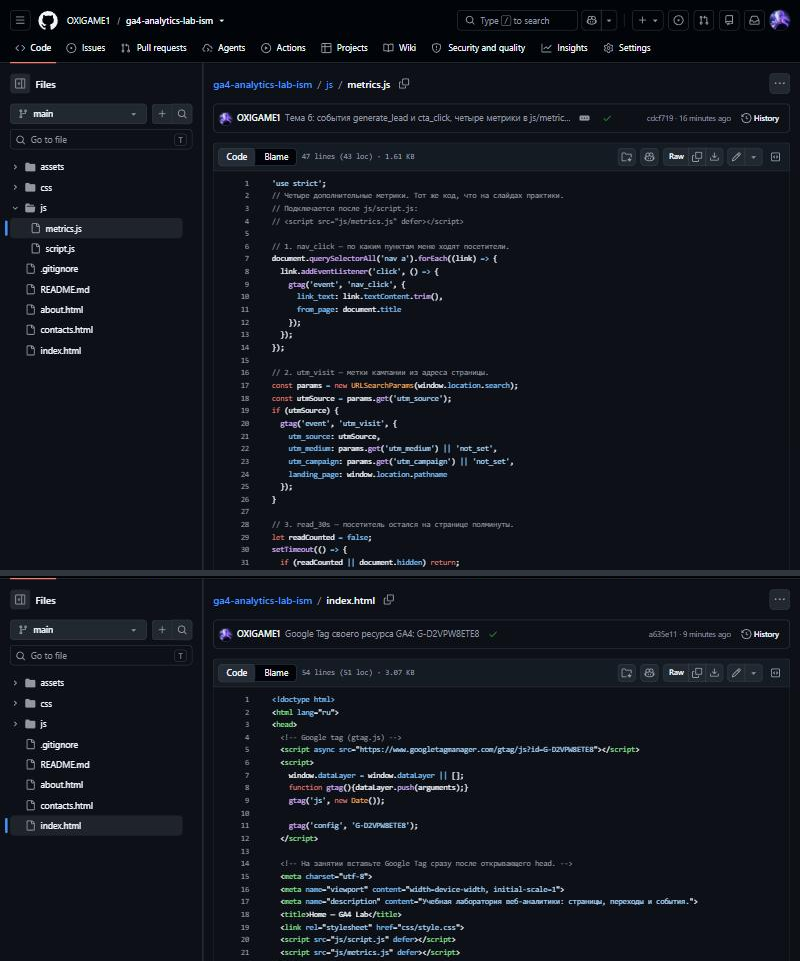
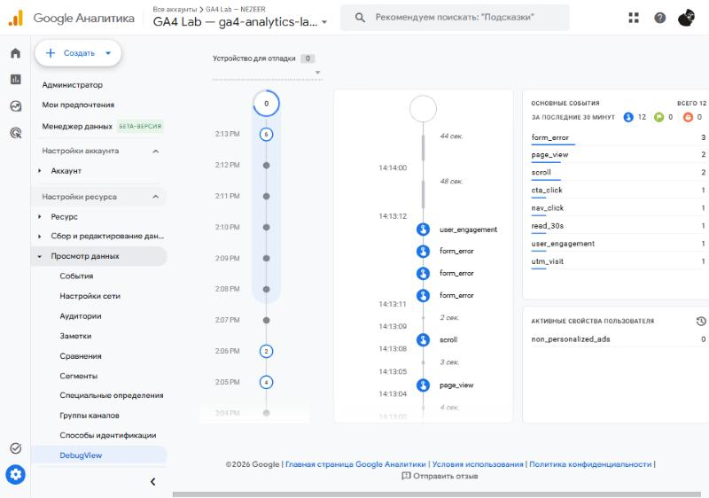
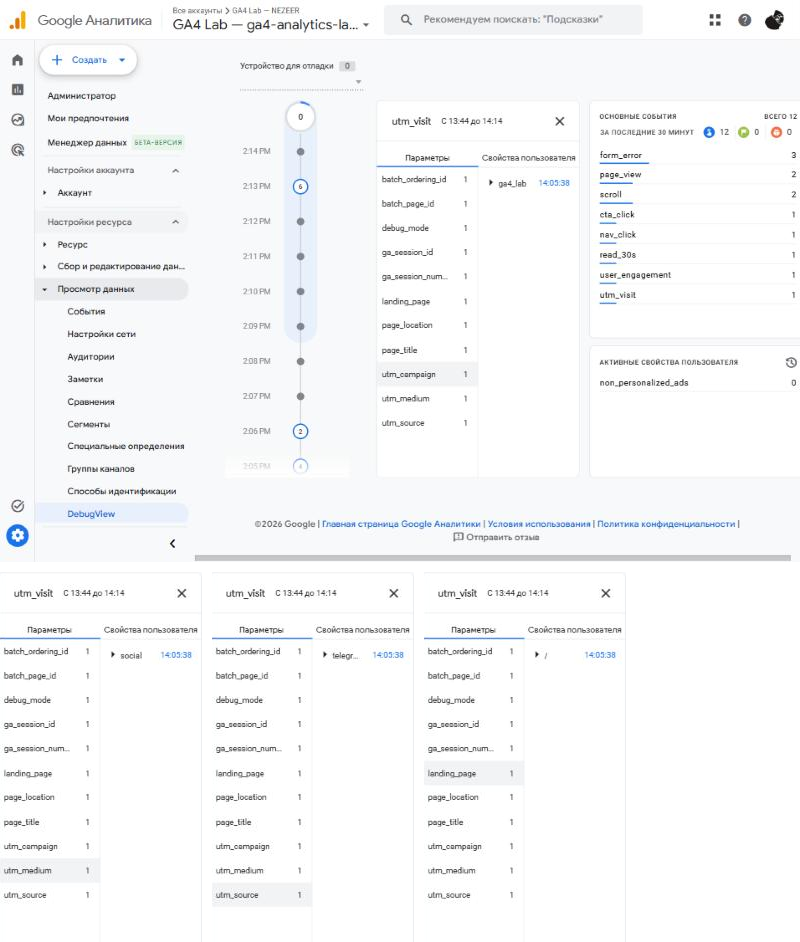
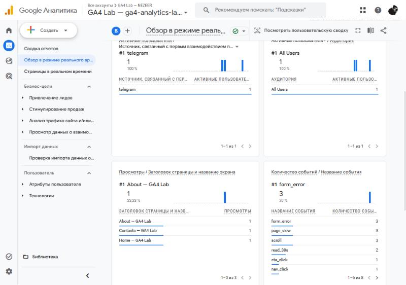

# Домашняя работа № 4 · Свои события и параметры в GA4

**Дисциплина:** ОП.03 «Информационные технологии»

| Поле | Значение |
|---|---|
| Фамилия, имя, отчество | Исмаилов Алишах Иса оглы |
| Группа |  |
| Номер работы | 4 |
| Тема работы | Свои события и параметры: четыре метрики на сайте |
| Дата сдачи |  |

---

## 1. Мой сайт и мой ресурс

| Поле | Значение |
|---|---|
| Публичный адрес сайта | https://ga4-analytics-lab-ism.vercel.app |
| Measurement ID (`G-…`) | `G-D2VPW8ETE8` |
| Коммит с метриками (ссылка или первые 7 символов) | [`cdcf719`](https://github.com/OXIGAME1/ga4-analytics-lab-ism/commit/cdcf719) |
| Статус публикации | READY |
| Страницы, где подключён `js/metrics.js` | `index.html`, `about.html`, `contacts.html` — после `js/script.js`, по одному разу |

Файл подключается после основного скрипта и на каждой странице по одному
разу: два подключения дают двойные события.

## 2. Какие метрики добавлены

| Событие | Что измеряет | Что делали, чтобы оно сработало |
|---|---|---|
| `nav_click` | клики по пунктам меню | на главной нажал пункт меню «Contacts» |
| `utm_visit` | метки кампании из адреса | открыл главную по ссылке с `utm_source`, `utm_medium`, `utm_campaign` |
| `read_30s` | полминуты на странице | оставался на главной больше 30 секунд, не переключая вкладку |
| `form_error` | форма не прошла проверку браузера | на Contacts нажал «Отправить заявку» с пустыми полями |



## 3. События в DebugView

| Поле | Значение |
|---|---|
| Дата и время проверки | 06.11.2026, 14:05–14:13 (МСК) |
| Как подключали отладку | `debug_mode`: в `gtag('config', …)` добавлен `debug_mode: true`, если в адресе есть `?debug_mode=1` (коммит [`5ad18f6`](https://github.com/OXIGAME1/ga4-analytics-lab-ism/commit/5ad18f6)) |
| Какие из четырёх событий пришли | все четыре: `nav_click`, `utm_visit`, `read_30s`, `form_error` (3 — по одному на каждое пустое обязательное поле: имя, email, направление) |
| Какие не пришли и почему | — |



## 4. Параметры события `utm_visit`

**Ссылка, по которой открывали сайт:**

```
https://ga4-analytics-lab-ism.vercel.app/?utm_source=telegram&utm_medium=social&utm_campaign=ga4_lab&debug_mode=1
```

| Параметр | Значение в ссылке | Значение в GA4 |
|---|---|---|
| `utm_source` | `telegram` | `telegram` |
| `utm_medium` | `social` | `social` |
| `utm_campaign` | `ga4_lab` | `ga4_lab` |
| `landing_page` | — | `/` |



Если значение в GA4 отличается от значения в ссылке, напишите, в чём разница
и почему так вышло.

> Значения совпадают. `debug_mode=1` в адресе — служебный параметр для DebugView,
> в `utm_visit` он не попадает.

## 5. Событие вне отладки

| Поле | Значение |
|---|---|
| Где проверяли | Realtime |
| Какое событие искали | `read_30s`, `form_error` |
| Сколько срабатываний показал экран | `read_30s` — 2, `form_error` — 3 |
| Период (для отчёта) | последние 30 минут, 06.11.2026 |



## 6. Что эти метрики показывают про сайт

Два-три предложения: что вы узнали о поведении посетителей из четырёх
новых событий. Например, по каким пунктам меню ходят чаще, доходит ли
кто-то до получаса чтения, спотыкается ли форма.

> Данных пока мало — это мои тестовые заходы. `read_30s` пришло дважды, значит
> полминуты на странице проводят. `form_error` срабатывает по разу на каждое
> незаполненное поле, поэтому по нему видно, какое поле чаще забывают.
> Из меню переходили в «About» и «Contacts».

## 7. Что не получилось

Если какая-то метрика не заработала, напишите какая, что показывал экран
и что было проверено по таблице из `README.md`. Незаполненный раздел
означает, что всё получилось.

>

## 8. Использование ИИ

Скрипты метрик выданы готовыми. Подключение, проверку и кадры вы делаете
сами. ИИ допускается для формулировок и оформления.

| Вопрос | Ответ |
|---|---|
| Что сделано самостоятельно |  |
| Что спрошено у модели |  |
| Что после этого изменено |  |
